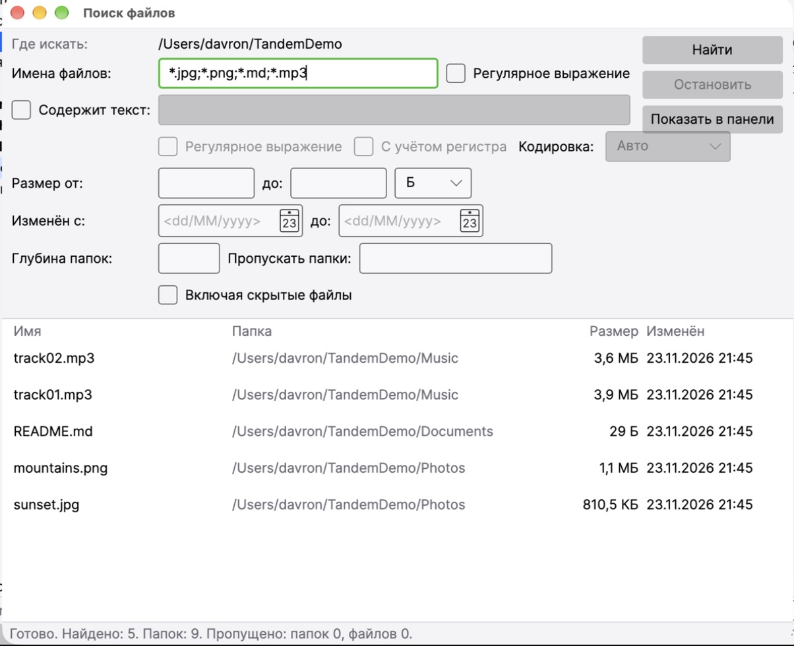

# Tandem

Tandem — двухпанельный файловый менеджер для macOS: две панели с вкладками, управление с клавиатуры, копирование
и перенос через очередь операций с окном прогресса, корзина, Quick Look, перетаскивание из Finder и в Finder,
права и теги, встроенная командная строка. На приёмке этап 3, версия 0.3.0.


## Скачать

Готовая сборка для Mac с Apple Silicon (M1 и новее), macOS 14 или новее, лежит в
[релизах](https://github.com/tdav/tandem/releases/latest): `Tandem-<версия>-macOS-arm64.zip`. Это Native AOT —
приложение скомпилировано в машинный код заранее, .NET устанавливать не нужно.

1. Распакуйте архив и перенесите `Tandem.app` в «Программы».
2. Сборка подписана ad-hoc, без сертификата Apple Developer, поэтому при первом запуске macOS её не откроет.
   Снимите карантин одной командой и запускайте как обычно:

   ```sh
   xattr -dr com.apple.quarantine /Applications/Tandem.app
   ```

   Или: правый щелчок по `Tandem.app` → «Открыть» → «Открыть»; на macOS 15 и новее — «Системные настройки →
   Конфиденциальность и безопасность → Всё равно открыть».

## Скриншоты

| Поиск файлов (Alt+F7) | Просмотр, режим hex (F3) | Настройки: клавиши (Cmd+,) |
| --- | --- | --- |
|  |  |  |

Возможности этапа 3:

- групповое переименование с предварительным просмотром и отменой последней операции;
- сравнение папок и файлов, синхронизация папок с выбором направления, создание и проверка контрольных сумм,
  подсчёт размеров папок;
- FTP, FTPS и SFTP в панелях, сохранённые подключения, восстановление связи после обрыва, правка через F4
  с сохранением на сервер;
- отдельные подключения через «Сеть → Подключиться по SSH…» открываются в окне консоли. SSH-консоль
  также доступна для сохранённых SFTP-подключений (Cmd+Alt+K). Правый щелчок копирует выделение, следующий
  вставляет его без Enter.

Возможности этапа 2:

- поиск файлов (Alt+F7, Cmd+F) по маскам, регулярным выражениям и содержимому в разных кодировках, с фильтрами по
  размеру, дате и глубине; результаты по ходу поиска и в панели как обычная папка (F3/F4/F5/F6/F8 оттуда);
- встроенный просмотр (F3): текст в разных кодировках, hex, изображения, файлы любого размера (несколько ГБ
  открываются сразу); панель просмотра (Ctrl+Q); встроенный редактор (F4) с сохранением кодировки или внешний
  редактор из настроек;
- архивы zip, 7z, tar, tar.gz, tar.bz2, tar.xz, rar: вход как в папку (Enter, Cmd+↓), копирование из них, архив в
  архиве, пароли; правка zip (копирование внутрь, удаление, переименование, новая папка, F4); упаковка в zip, tar и
  tar.gz (Alt+F5) и распаковка (Alt+F9);
- настройки (Cmd+,): переназначение клавиш, темы (светлая, тёмная, как в системе), цвета по типам файлов, столбцы
  отдельно для каждой панели, шрифт и высота строк, панель кнопок с пользовательскими командами.

Чтение RAR и 7z с зашифрованным списком файлов не проверено автоматическими тестами: таких тестовых архивов в
проекте нет, их можно проверить только на своих файлах. Остальные ограничения — в конце `docs/checklists/stage-2.md`.

## Требования для сборки из исходников

- Mac с Apple Silicon (arm64), macOS 14 или новее;
- .NET 11 SDK (`dotnet --version` → 11.x).

## Сборка, тесты, пакет

```sh
dotnet build Tandem.slnx          # сборка
dotnet test Tandem.slnx           # все тесты
build/make-app.sh                 # пакет dist/Tandem.app (Release, osx-arm64, самодостаточный, ReadyToRun)
build/make-aot-app.sh             # пакет dist/Tandem.app в Native AOT и архив dist/Tandem-<версия>-macOS-arm64.zip
build/verify-app.sh               # проверка пакета: структура, Info.plist, архитектура, подпись, пробный запуск
open dist/Tandem.app              # запуск
```

`build/create-dev-cert.sh` — необязательный разовый шаг: создаёт в связке ключей входа самоподписанный сертификат
«Tandem Local Dev», чтобы разрешения macOS на папки не сбрасывались после каждой пересборки. Без него пакет
подписывается ad-hoc и всё работает. Скрипт объясняет, что добавит, и спрашивает подтверждение.

Настройки: `~/Library/Application Support/Tandem/` — `state.json` (вкладки, избранное, окно, меню «Вид»; формат
этапа 1), `settings.json` (клавиши, тема, цвета, столбцы, шрифт, панель кнопок, внешний редактор),
`known-hosts.json` (подтверждённые ключи и сертификаты) и `connections.json` (подключения до перехода
на зашифрованное хранилище). Временные файлы:
`~/Library/Caches/Tandem/tmp`. Журнал ошибок: `~/Library/Logs/Tandem/tandem.log`.

### Зашифрованное хранилище подключений

Откройте «Сеть → Подключиться к серверу…» и выберите создание хранилища. Tandem поместит профили FTP, FTPS
и SFTP, профили SSH, сохранённые пароли, закрытые SSH-ключи и ключевые фразы в `credentials.tandemvault` в папке настроек.
После перехода Tandem читает и обновляет этот файл. Ранее сохранённые записи macOS Keychain и исходные файлы
ключей сохраняются. Для переноса нужен зашифрованный файл и мастер-пароль. Хранилище открывается по
мастер-паролю в каждом запуске Tandem, когда требуются подключения.
[Спецификация формата для совместимых приложений](docs/superpowers/specs/2026-11-21-credential-vault-design.md).

## Проверки на настоящем сервере

По умолчанию сетевые автотесты работают на loopback или с поддельными источниками. Проверки на FTP, FTPS
и SFTP включаются переменными окружения. [Инструкция для сетевых тестов](tests/Tandem.Net.Tests/README.md).

## Документы

- Спецификация: `docs/superpowers/specs/2026-11-19-dual-pane-file-manager-design.md`
- План этапа 1: `docs/superpowers/plans/2026-11-19-stage-1-core-navigation-macos.md`
- План этапа 2: `docs/superpowers/plans/2026-11-19-stage-2-search-view-archives-settings.md`
- [План этапа 3](docs/superpowers/plans/2026-11-21-stage-3-tools-network.md)
- Ручная приёмка этапа 1: `docs/checklists/stage-1.md`
- Ручная приёмка этапа 2: `docs/checklists/stage-2.md`
- [Ручная приёмка этапа 3](docs/checklists/stage-3.md)

## Структура

- `src/Tandem.Core` — источники файлов, движок операций, маски, сортировка, поиск, кодировки, настройки (без
  интерфейса и macOS API);
- `src/Tandem.Archives` — архивы как источники файлов (чтение, правка zip, упаковка) на библиотеке SharpCompress;
- `src/Tandem.Net` — FTP, FTPS и SFTP как источники файлов, подключения и SSH-консоль;
- `src/Tandem.Platform.Mac` — корзина, копирование средствами системы, тома, Quick Look, запуск программ;
- `src/Tandem.App` — интерфейс на Avalonia (просмотр, редактор на AvaloniaEdit, поиск, настройки);
- `tests/` — тесты для каждого проекта;
- `build/` — скрипты сборки пакета.

---

## English

Tandem is a dual-pane file manager for macOS (C#, .NET 11, Avalonia). Stage 1 covers the core panels, tabs,
favourites and history, the operation queue (copy, move, delete to Trash), drag and drop with Finder, Quick Look,
permissions and Finder tags, and a built-in command line. Stage 2 adds file
search with results shown in a panel; a built-in viewer (text in several encodings, hex, images, multi-gigabyte
files), a quick-view panel and a text editor; archives (zip, 7z, tar, tar.gz/bz2/xz, rar) browsed as folders,
zip editing, packing into zip/tar/tar.gz and unpacking; and settings: rebindable shortcuts, light/dark/system themes,
file-type colours, per-panel columns, font and row height, and a user button bar. The UI is available in English and
Russian. Reading RAR archives and 7z archives with encrypted headers is untested: the project has no such test
archives, so only your own files can check it.

Stage 3 (0.3.0, in acceptance testing) adds batch rename with preview and undo, folder and file comparison,
folder synchronization, checksums and directory sizes. FTP, FTPS and SFTP connections can appear in either pane,
reconnect after a dropped connection and upload edits made in the built-in editor. Use Network → Connect via SSH…
for console-only profiles. Saved SFTP profiles can also open an SSH console. Right-click copies a selection, then
right-click again to paste without pressing Enter. [Stage 3 acceptance checklist](docs/checklists/stage-3.md).

**Download.** A Native AOT build for Apple Silicon Macs (macOS 14+) is attached to the
[latest release](https://github.com/tdav/tandem/releases/latest) as `Tandem-<version>-macOS-arm64.zip`; no .NET
install is needed. The app is signed ad-hoc (no Apple Developer certificate), so after moving it to Applications
clear the quarantine flag once: `xattr -dr com.apple.quarantine /Applications/Tandem.app` (or right-click → Open).

Requirements for building from source: Apple Silicon Mac, macOS 14+, .NET 11 SDK.

```sh
dotnet test Tandem.slnx     # run all tests
build/make-app.sh           # build dist/Tandem.app (self-contained, osx-arm64, signed)
build/make-aot-app.sh       # Native AOT dist/Tandem.app plus dist/Tandem-<version>-macOS-arm64.zip
build/verify-app.sh         # verify the bundle
open dist/Tandem.app
```

`build/create-dev-cert.sh` optionally creates a self-signed code-signing certificate in your login keychain so
that macOS folder permissions survive rebuilds; without it the app is signed ad-hoc and works the same.

Settings live in `~/Library/Application Support/Tandem/`: `state.json` (tabs, favourites, window; stage 1 format) and
`settings.json` (stage 2 settings), `credentials.tandemvault` (the portable encrypted vault after setup),
`connections.json` (legacy profiles) and `known-hosts.json` (trusted keys and certificates).
Enable the vault from the Network connection manager. A compatible reader uses the encrypted file and master
password. [Vault format specification](docs/superpowers/specs/2026-11-21-credential-vault-design.md).

Projects: `src/Tandem.Core`,
`src/Tandem.Archives` (archives over SharpCompress), `src/Tandem.Net` (files over FTP/FTPS/SFTP and SSH consoles),
`src/Tandem.Platform.Mac`, `src/Tandem.App`.

Live protocol tests are opt-in. [Network test instructions](tests/Tandem.Net.Tests/README.md).

Design: `docs/superpowers/specs/2026-11-19-dual-pane-file-manager-design.md`;
plans: `docs/superpowers/plans/2026-11-19-stage-1-core-navigation-macos.md`,
`docs/superpowers/plans/2026-11-19-stage-2-search-view-archives-settings.md`;
acceptance checklists (Russian): `docs/checklists/stage-1.md`, `docs/checklists/stage-2.md`.
