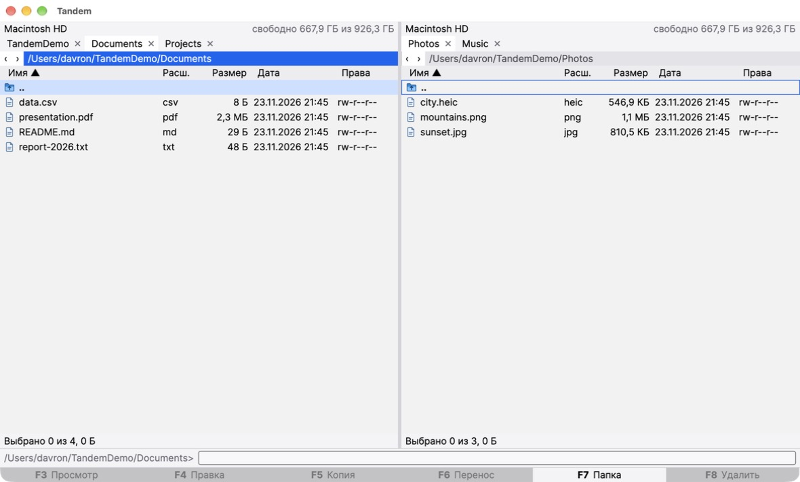
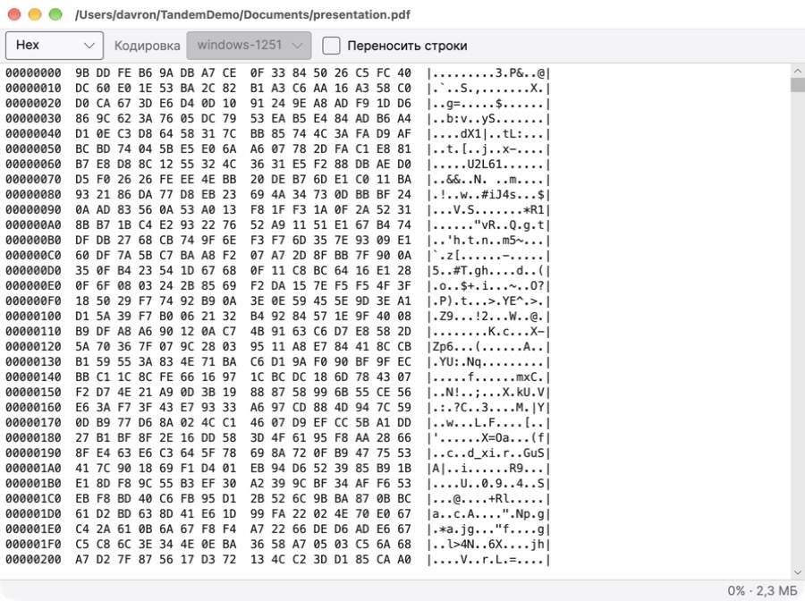
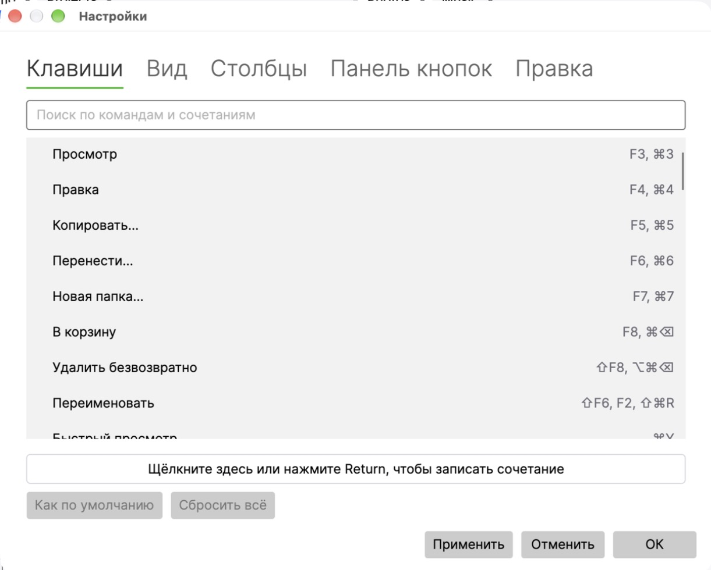
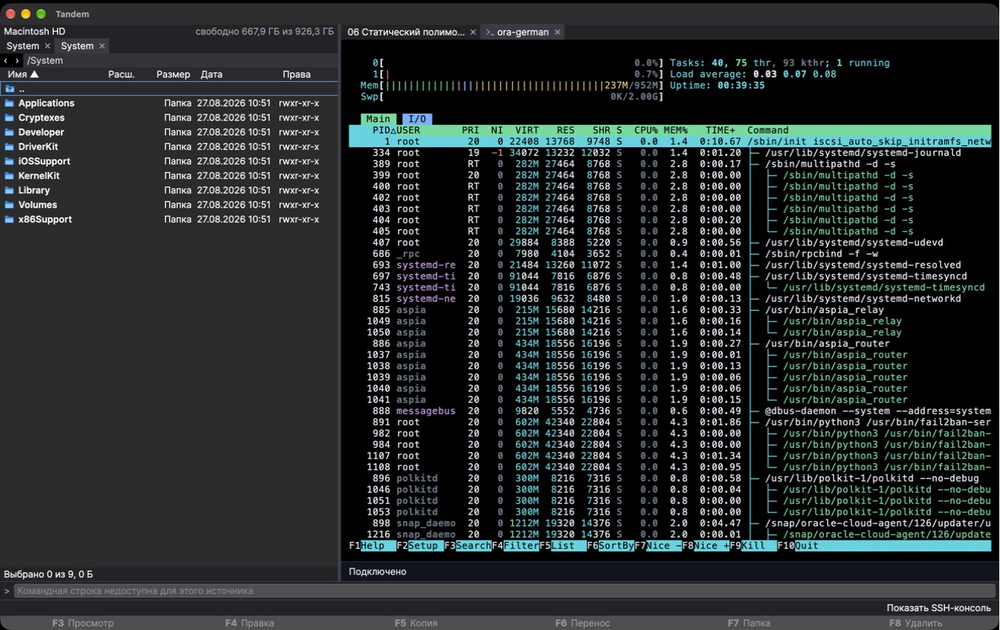

**English** | [Русский](README.ru.md)

# Tandem

Tandem is a dual-pane file manager for macOS: two panels with tabs, keyboard control, copying and moving through
an operation queue with a progress window, Trash, Quick Look, drag and drop from and to Finder, permissions and
tags, a built-in command line, FTP/FTPS/SFTP and an SSH console. Current version: 0.4.0.



## Download

A ready-made build for Apple Silicon Macs (M1 and newer), macOS 14 or newer, is available in
[releases](https://github.com/tdav/tandem/releases/latest): `Tandem-<version>-macOS-arm64.zip`. It is Native AOT —
the app is compiled ahead of time to machine code, so you do not need to install .NET.

1. Unpack the archive and move `Tandem.app` to Applications.
2. The build is signed ad-hoc, without an Apple Developer certificate, so macOS will not open it on first launch.
   Remove the quarantine flag with one command and launch it as usual:

   ```sh
   xattr -dr com.apple.quarantine /Applications/Tandem.app
   ```

   Or: right-click `Tandem.app` → Open → Open; on macOS 15 and newer — System Settings →
   Privacy & Security → Open Anyway.

### Windows x64 (preview)

Windows 10/11 x64: `Tandem-<version>-win-x64.zip` in the
[releases](https://github.com/tdav/tandem/releases) (marked pre-release). It is Native AOT, compiled ahead of time to
machine code, so .NET does not need to be installed. Unpack it anywhere and run `Tandem.exe` (keep the
three DLLs beside it). The exe is not signed, so SmartScreen may warn once:
"More info" → "Run anyway".

On Windows the shortcuts use Ctrl where macOS uses ⌘, in the style of classic two-pane managers (Ctrl+R reread,
Ctrl+U swap panels, Ctrl+D favourites, Ctrl+F connect, Ctrl+F3…F7 sort, Delete / Shift+Delete). The root `/` of the
local disk lists the drives. Settings live in `%APPDATA%\Tandem`, logs in `%LOCALAPPDATA%\Tandem\Logs`. Not
available on Windows: Finder tags, Quick Look (the built-in quick view, Ctrl+Q, works), the file owner, "Open with"
lists. Saved passwords go to the Windows Credential Manager.

## Screenshots

| Find files (Alt+F7) | Viewer, hex mode (F3) | Settings: keys (Cmd+,) |
| --- | --- | --- |
|  |  |  |

## What's new in 0.4.0

- The SSH console can be opened right in a file panel tab, next to regular folder tabs. The mode is chosen in
  Settings → SSH console: in a panel tab or in a separate window, and also in which panel (left or right) new
  tabs appear. Drag the divider to change the panel widths.
- The "Show SSH console" button below the panels takes you back to the open console.



Stage 3 features:

- batch rename with preview and undo of the last operation;
- folder and file comparison, folder synchronization with a choice of direction, creating and verifying
  checksums, calculating folder sizes;
- FTP, FTPS and SFTP in the panels, saved connections, reconnecting after a dropped connection, editing with F4
  and saving back to the server;
- standalone connections via Network → Connect via SSH… open in a console — in a separate window or
  in a panel tab (see 0.4.0). The SSH console
  is also available for saved SFTP connections (Cmd+Alt+K). Right-click copies the selection, the next one
  pastes it without Enter.

Stage 2 features:

- file search (Alt+F7, Cmd+F) by masks, regular expressions and content in different encodings, with filters by
  size, date and depth; results appear as the search runs and in a panel as a regular folder (F3/F4/F5/F6/F8 from
  there);
- built-in viewer (F3): text in different encodings, hex, images, files of any size (several GB open
  instantly); quick-view panel (Ctrl+Q); built-in editor (F4) that preserves the encoding, or an external
  editor from the settings;
- archives zip, 7z, tar, tar.gz, tar.bz2, tar.xz, rar: enter them like a folder (Enter, Cmd+↓), copy from them,
  archives inside archives, passwords; zip editing (copy in, delete, rename, new folder, F4); packing into zip, tar
  and tar.gz (Alt+F5) and unpacking (Alt+F9);
- settings (Cmd+,): key rebinding, themes (light, dark, system), colours by file type, columns
  separately for each panel, font and row height, a button bar with user commands.

Reading RAR and 7z archives with an encrypted file list is not covered by automated tests: the project has no such
test archives, so it can only be checked on your own files. Other limitations are listed at the end of
`docs/checklists/stage-2.md` (in Russian).

## Requirements for building from source

- Mac with Apple Silicon (arm64), macOS 14 or newer;
- .NET 11 SDK (`dotnet --version` → 11.x).

## Build, tests, package

```sh
dotnet build Tandem.slnx          # build
dotnet test Tandem.slnx           # all tests
build/make-app.sh                 # package dist/Tandem.app (Release, osx-arm64, self-contained, ReadyToRun)
build/make-aot-app.sh             # package dist/Tandem.app as Native AOT plus archive dist/Tandem-<version>-macOS-arm64.zip
build/verify-app.sh               # verify the package: structure, Info.plist, architecture, signature, test launch
open dist/Tandem.app              # launch
```

`build/create-dev-cert.sh` is an optional one-time step: it creates a self-signed certificate
"Tandem Local Dev" in your login keychain so that macOS folder permissions are not reset after every rebuild.
Without it the package is signed ad-hoc and everything works. The script explains what it will add and asks for
confirmation.

Settings: `~/Library/Application Support/Tandem/` — `state.json` (tabs, favourites, window, View menu; stage 1
format), `settings.json` (keys, theme, colours, columns, font, button bar, external editor),
`known-hosts.json` (trusted keys and certificates) and `connections.json` (connections from before the switch
to the encrypted vault). Temporary files:
`~/Library/Caches/Tandem/tmp`. Error log: `~/Library/Logs/Tandem/tandem.log`.

### Encrypted connection vault

Open Network → Connect to server… and choose to create a vault. Tandem will put FTP, FTPS
and SFTP profiles, SSH profiles, saved passwords, private SSH keys and passphrases into `credentials.tandemvault`
in the settings folder. After the switch Tandem reads and updates this file. Previously saved macOS Keychain
entries and the original key files are kept. To move it elsewhere you need the encrypted file and the master
password. The vault is unlocked with the master password in each Tandem session when connections are needed.
[Format specification for compatible applications](docs/superpowers/specs/2026-11-21-credential-vault-design.md).

## Tests against a real server

By default the network tests run on loopback or with fake sources. Tests against FTP, FTPS
and SFTP are enabled with environment variables. [Network test instructions](tests/Tandem.Net.Tests/README.md).

## Documents

All documents below are in Russian.

- Specification: `docs/superpowers/specs/2026-11-19-dual-pane-file-manager-design.md`
- Stage 1 plan: `docs/superpowers/plans/2026-11-19-stage-1-core-navigation-macos.md`
- Stage 2 plan: `docs/superpowers/plans/2026-11-19-stage-2-search-view-archives-settings.md`
- [Stage 3 plan](docs/superpowers/plans/2026-11-21-stage-3-tools-network.md)
- Stage 1 manual acceptance: `docs/checklists/stage-1.md`
- Stage 2 manual acceptance: `docs/checklists/stage-2.md`
- [Stage 3 manual acceptance](docs/checklists/stage-3.md)

## Structure

- `src/Tandem.Core` — file sources, operation engine, masks, sorting, search, encodings, settings (no
  UI or macOS APIs);
- `src/Tandem.Archives` — archives as file sources (reading, zip editing, packing) built on SharpCompress;
- `src/Tandem.Net` — FTP, FTPS and SFTP as file sources, connections and the SSH console;
- `src/Tandem.Platform.Mac` — Trash, copying with system facilities, volumes, Quick Look, launching applications;
- `src/Tandem.App` — Avalonia UI (viewer, AvaloniaEdit-based editor, search, settings);
- `tests/` — tests for each project;
- `build/` — package build scripts.

## License

[MIT](LICENSE)
